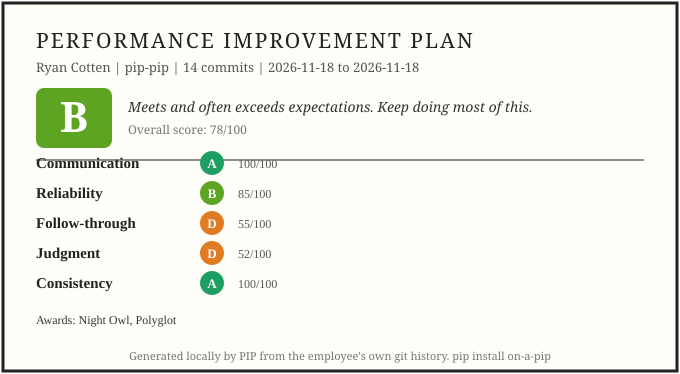

# PIP: the performance review where the AI reviews *you*

Every AI tool reviews your code. **PIP reviews the programmer.**

Every developer keeps a work diary without knowing it: their git history. Every change is in there, with a timestamp and a little note that was supposed to explain it. PIP reads that record, locally, on your own machine, and issues a formal manager-style performance review. With evidence.

```
pip install on-a-pip
```

Then, inside any git repository:

```
on-a-pip
```

Or review somebody else's, straight from the internet:

```
on-a-pip psf/requests                      # GitHub shorthand
on-a-pip https://github.com/psf/requests    # any git URL
on-a-pip psf/requests --leaderboard        # rank the whole team
```

PIP clones the repo into a temp folder, reviews it, and deletes the clone when it is done (`--keep` keeps it, `--shallow 500` fetches only recent history on huge repos). Reviewing a famous project is an education: the creator of Requests, 3,148 commits deep, grades out at a D with a Night Owl award. The record is the record.

```
  PERFORMANCE IMPROVEMENT PLAN  -  Dev Example
  pip-sample  |  8 commits reviewed  |  2025-10-14 to 2026-11-08
  --------------------------------------------------------------
  Communication    F    32.5  ######
  Reliability      C    64.4  ############
  Follow-through   B    84.3  ################
  Judgment         B    83.8  #################
  Consistency      D    43.0  ########
  --------------------------------------------------------------
  OVERALL          C    61.6
  Meets some expectations. There is a conversation to be had.
```

(That is a real review of a deliberately terrible sample history. Yours will be different. Possibly worse.)

## What it grades

- **Communication.** How many of your commit messages actually say anything. "stuff", "wip" and "asdf" are entered into the record, quoted back at you.
- **Reliability.** Commits between 10pm and 5am. Commits shipped Friday after 4pm. Reverts. Chains of commits that start with "fix".
- **Follow-through.** The TODOs still sitting in your code, and how old the oldest one is. A TODO that has been waiting 400 days has seniority.
- **Judgment.** The spots labelled "temporary", "hack" or "workaround", and how long the oldest one has been load-bearing.
- **Consistency.** Active days versus silent stretches, longest streak, longest disappearance.

Then it does what any good PIP does: it writes you a **30-day improvement plan**, generated from your three weakest categories, and signs off with the only appeal process that has ever worked: improve the record.

## Awards

Grades are the paperwork. Awards are the part people post. PIP reads your habits and hands out titles, each one earned by the record:

- **Night Owl** - a quarter or more of your commits land between 10pm and 5am
- **Friday Gambler** - repeated Friday-after-4pm shipping
- **Demolitionist** - you delete more than you add, at scale
- **The Ghost** - a 60+ day disappearance, then a casual return
- **Fossil Keeper** - a TODO old enough to qualify for the pension plan
- **Surgeon**, **Streak Keeper**, **Open Book**, **Strong Silent Type**, **Chaos Agent**, **Weekend Warrior**, **Colourful Commentator**
- **Marathon Day** (15+ commits in one day), **The Purge** (a single commit deleting 1,000+ lines), **Polyglot** (real churn in 5+ languages), **Old Faithful** (3+ years on one codebase), **Phoenix** (a long disappearance followed by a genuine comeback)

It also names your **nemesis file** (the one with the most churn in your history) and your largest single commit, because management did the reading.

## Choose your manager

```
on-a-pip --persona brutal       # the startup CTO
on-a-pip --persona supportive   # the kind lead
on-a-pip --persona passive      # the passive-aggressive middle manager
on-a-pip --persona corporate    # the default. HR is present.
```

The evidence never changes. The tone absolutely does.

## More ways to be reviewed

```
on-a-pip ~/some/repo --md review.md --html card.html --svg card.svg --badge badge.svg
on-a-pip --author "your name"     # review one author (default: the most prolific)
on-a-pip --days 90                # just the last 90 days of history
on-a-pip --since 2026-01-01 --until 2026-03-31   # or a calendar window
on-a-pip --reference letter.md    # also write a letter of reference, based on the grade
on-a-pip --vs "Alice" "Bob"       # head to head: two authors, one repo, one winner
on-a-pip --scan ~/projects        # review the top author of every repo in a folder
on-a-pip --quarter                # the quarterly ritual: last 90 days, compared to your last review
on-a-pip --leaderboard            # review every author in the repo and rank them
on-a-pip psf/requests               # or skip the local part entirely: any public repo by URL
on-a-pip --json                   # machine-readable review
```

- The terminal summary above, now with awards, and a progress line comparing you to your last review (PIP remembers, locally).
- A full formal review in Markdown: per-category evidence, management notes, additional findings, awards, the plan, the sign-off.
- Shareable **report cards** in HTML and **SVG** (the SVG embeds straight into a README), plus a small **grade badge** for your profile.
- A **leaderboard mode** for shared repos. Run it on your team. We accept no responsibility for the standup that follows.
- A **letter of reference** (`--reference`), written by management in the tone your grade deserves. A grades get a glowing letter. F grades get a short one.
- Career stats in every review: busiest day ever, monthly activity sparkline, languages ranked by churn. Identities are grouped by email, so one person under two names is one employee, and two people sharing a name stay two rows.
- **Head-to-head mode** (`--vs`): two authors compared category by category, with a declared winner and consequences for the loser.
- **Folder scan** (`--scan`): point PIP at a directory of projects and get one ranked board of every repo's top author.
- **Mailmap support:** if the repo has a `.mailmap`, PIP honors it, so identity merging follows the project's own records.

Sample outputs live in [`examples/`](examples/): a full sample review, sample report cards, a badge, and a real report card generated from the Decksmith repository.

## Wear your grade

```
on-a-pip --readme
```

Run inside your repo, this writes `pip-card.svg` and `pip-badge.svg` and adds a marked **My PIP review** section to your README (the one at the bottom of this README is PIP reviewing this repo). Re-run it any time to refresh the grade.

To keep it current automatically, use the GitHub Action in your workflow:

```yaml
name: pip-review
on:
  push:
    branches: [main]
permissions:
  contents: write
jobs:
  review:
    runs-on: ubuntu-latest
    steps:
      - uses: actions/checkout@v4
        with:
          fetch-depth: 0
      - uses: littlestjames82-sys/pip-pip@main
```

Every push gets a fresh review, committed by the bot. Your README becomes a living performance record, which is either motivating or a threat, depending on your habits.

## Private by construction

PIP runs `git log`, `git grep` and `git blame` on your machine and nothing else. No network, no account, no API key, no telemetry, pure Python standard library. Your history is embarrassing enough without uploading it somewhere.

## Requirements

- Python 3.9+
- git, on your PATH

## Honest notes

- The package is called `on-a-pip` because PyPI rejected `pip-pip` as too similar to `pip` itself, which is fair: you do not get to out-pip pip. The tool was going to be `pip install pip-pip`. Now you install the news that you are on one.
- Grades are deterministic: same history, same review. The formulas are plain arithmetic in one file, `pip_pip.py`, if you want to argue with them.
- PIP reviews the most prolific author in the repo by default. Use `--author` in shared repos.

## License

MIT. Built by [Ghost Developer Studio](https://ghostdeveloperstudio.com).

<!-- pip:start -->
## My PIP review




**Grade: B (78/100)** · 15 commits reviewed · Top award: Night Owl · Reviewed 2026-11-19

*This section is maintained by [PIP](https://pypi.org/project/on-a-pip/) (`on-a-pip --readme`). The record speaks for itself.*
<!-- pip:end -->
