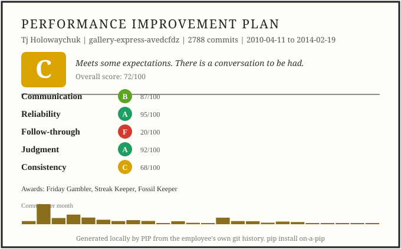
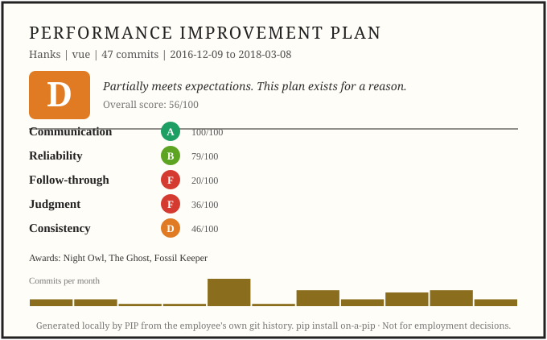
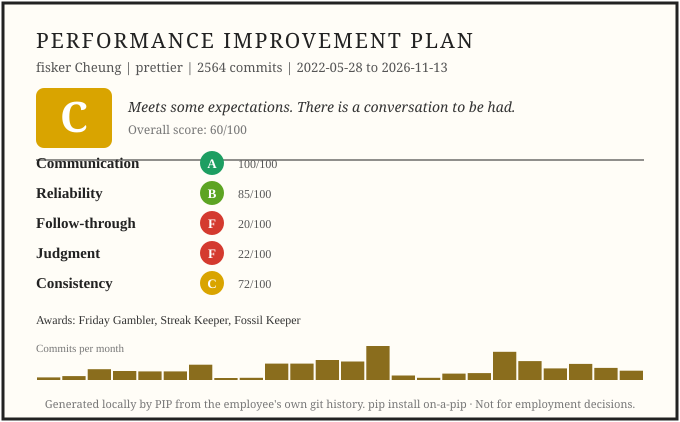
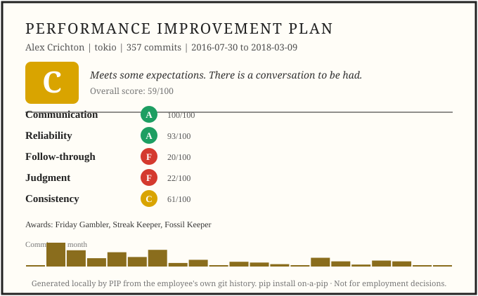

# The PIP Gallery: famous projects, formally reviewed

Every card below was generated by PIP itself from the project's real git
history. No author was consulted. Several would like to speak to HR.

## requests

Top author: **Cory Benfield**, grade **C (65/100)**, 606 commits reviewed.

| # | Author | Grade | Score | Commits |
| --- | --- | --- | --- | --- |
| 1 | Cory Benfield | C | 64.8 | 606 |
| 2 | Nate Prewitt | C | 60.3 | 348 |
| 3 | Kenneth Reitz | C | 59.1 | 928 |
| 4 | Ian Cordasco | C | 58.2 | 298 |
| 5 | Kenneth Reitz | D | 57.0 | 1006 |

[Full review of Cory Benfield](requests/review.md)

## flask

Top author: **David Lord**, grade **C (62/100)**, 1870 commits reviewed.

| # | Author | Grade | Score | Commits |
| --- | --- | --- | --- | --- |
| 1 | David Lord | C | 62.4 | 1870 |
| 2 | Ron DuPlain | C | 62.1 | 117 |
| 3 | Markus Unterwaditzer | D | 57.0 | 274 |
| 4 | Grey Li | D | 55.7 | 109 |
| 5 | Armin Ronacher | D | 55.2 | 733 |

[Full review of David Lord](flask/review.md)

## express

Top author: **Tj Holowaychuk**, grade **C (72/100)**, 2788 commits reviewed.

| # | Author | Grade | Score | Commits |
| --- | --- | --- | --- | --- |
| 1 | Tj Holowaychuk | C | 72.3 | 2788 |
| 2 | Jonathan Ong | C | 68.0 | 84 |
| 3 | Roman Shtylman | C | 67.5 | 70 |
| 4 | Ulises Gascón | C | 65.9 | 63 |
| 5 | Douglas Christopher Wilson | C | 64.1 | 1232 |

[Full review of Tj Holowaychuk](express/review.md)

## normalize-css

Top author: **battaglr**, grade **B (75/100)**, 10 commits reviewed.

| # | Author | Grade | Score | Commits |
| --- | --- | --- | --- | --- |
| 1 | battaglr | B | 75.0 | 10 |
| 2 | Nicolas Gallagher | C | 72.1 | 208 |
| 3 | Jonathan Neal | C | 69.3 | 95 |

[Full review of battaglr](normalize-css/review.md)

## fastapi

Top author: **Sebastián Ramírez**, grade **C (59/100)**, 1209 commits reviewed.

| # | Author | Grade | Score | Commits |
| --- | --- | --- | --- | --- |
| 1 | Sebastián Ramírez | C | 59.2 | 1209 |
| 2 | Yurii Motov | D | 57.4 | 72 |
| 3 | Nils Lindemann | D | 57.1 | 129 |
| 4 | Alejandra | D | 56.3 | 102 |
| 5 | Motov Yurii | D | 55.5 | 234 |

[Full review of Sebastián Ramírez](fastapi/review.md)

## vue

Top author: **Hanks**, grade **D (56/100)**, 47 commits reviewed.

| # | Author | Grade | Score | Commits |
| --- | --- | --- | --- | --- |
| 1 | Hanks | D | 56.3 | 47 |
| 2 | kazuya kawaguchi | D | 56.1 | 32 |
| 3 | chengchao | D | 55.2 | 34 |
| 4 | Eduardo San Martin Morote | D | 49.8 | 43 |
| 5 | Evan You | D | 48.8 | 2592 |

[Full review of Hanks](vue/review.md)

## prettier

Top author: **fisker Cheung**, grade **C (60/100)**, 2564 commits reviewed.

| # | Author | Grade | Score | Commits |
| --- | --- | --- | --- | --- |
| 1 | fisker Cheung | C | 59.8 | 2564 |
| 2 | SUZUKI Sosuke | D | 54.2 | 184 |
| 3 | Seiya | D | 53.5 | 50 |
| 4 | Sosuke Suzuki | D | 52.1 | 137 |
| 5 | Georgii Dolzhykov | D | 49.7 | 51 |

[Full review of fisker Cheung](prettier/review.md)

## tokio

Top author: **Alex Crichton**, grade **C (59/100)**, 357 commits reviewed.

| # | Author | Grade | Score | Commits |
| --- | --- | --- | --- | --- |
| 1 | Alex Crichton | C | 59.1 | 357 |
| 2 | Alice Ryhl | D | 55.7 | 317 |
| 3 | Alice Ryhl | D | 55.6 | 434 |
| 4 | Carl Lerche | D | 54.5 | 653 |
| 5 | Taiki Endo | D | 52.4 | 184 |

[Full review of Alex Crichton](tokio/review.md)

*Generated by PIP. `pip install on-a-pip` and review your own history.*
