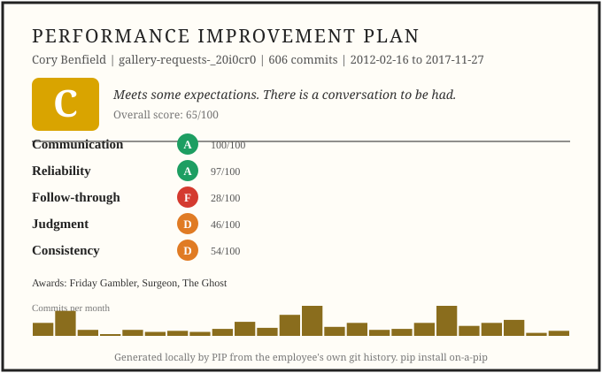
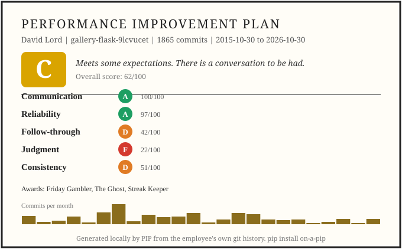
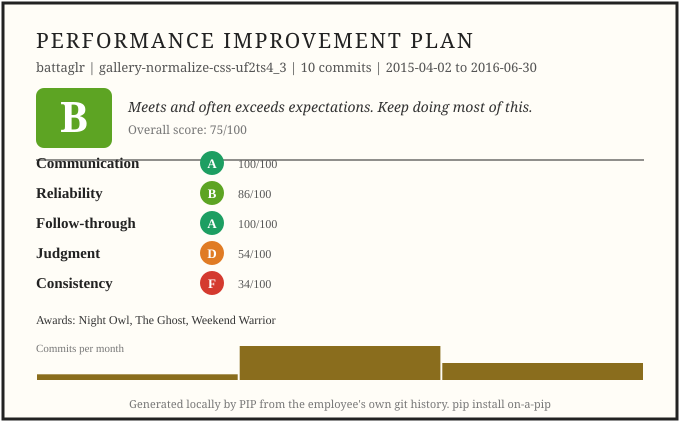

# The PIP Gallery: famous projects, formally reviewed

Every card below was generated by PIP itself from the project's real git
history. No author was consulted. Several would like to speak to HR.

## gallery-requests-_20i0cr0

Top author: **Cory Benfield**, grade **C (65/100)**, 606 commits reviewed.

| # | Author | Grade | Score | Commits |
| --- | --- | --- | --- | --- |
| 1 | Cory Benfield | C | 64.8 | 606 |
| 2 | Nate Prewitt | C | 60.2 | 340 |
| 3 | Kenneth Reitz | C | 59.1 | 928 |
| 4 | Ian Cordasco | C | 58.2 | 294 |
| 5 | Kenneth Reitz | D | 57.0 | 1006 |

[Full review of Cory Benfield](requests/review.md)

## gallery-flask-9lcvucet

Top author: **David Lord**, grade **C (62/100)**, 1865 commits reviewed.

| # | Author | Grade | Score | Commits |
| --- | --- | --- | --- | --- |
| 1 | David Lord | C | 62.4 | 1865 |
| 2 | Ron DuPlain | C | 62.1 | 117 |
| 3 | Markus Unterwaditzer | D | 57.0 | 274 |
| 4 | Grey Li | D | 55.9 | 105 |
| 5 | Armin Ronacher | D | 55.2 | 733 |

[Full review of David Lord](flask/review.md)

## gallery-express-avedcfdz

Top author: **Tj Holowaychuk**, grade **C (72/100)**, 2788 commits reviewed.

| # | Author | Grade | Score | Commits |
| --- | --- | --- | --- | --- |
| 1 | Tj Holowaychuk | C | 72.3 | 2788 |
| 2 | dependabot[bot] | C | 69.8 | 57 |
| 3 | Jonathan Ong | C | 68.0 | 84 |
| 4 | Roman Shtylman | C | 67.5 | 70 |
| 5 | Douglas Christopher Wilson | C | 64.1 | 1232 |

[Full review of Tj Holowaychuk](express/review.md)

## gallery-normalize-css-uf2ts4_3

Top author: **battaglr**, grade **B (75/100)**, 10 commits reviewed.

| # | Author | Grade | Score | Commits |
| --- | --- | --- | --- | --- |
| 1 | battaglr | B | 75.0 | 10 |
| 2 | Nicolas Gallagher | C | 72.1 | 208 |
| 3 | Jonathan Neal | C | 69.3 | 95 |

[Full review of battaglr](normalize-css/review.md)

*Generated by PIP. `pip install on-a-pip` and review your own history.*
