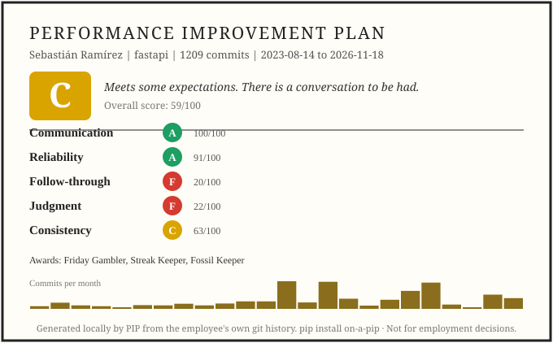
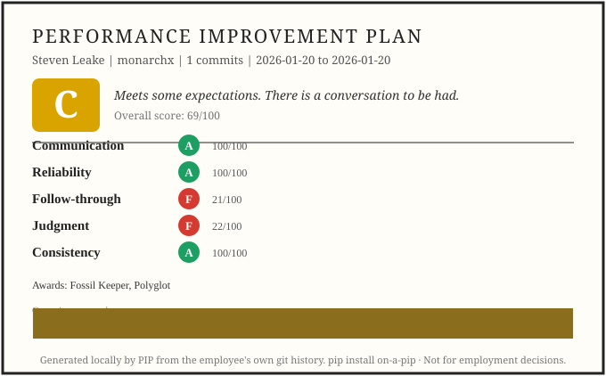
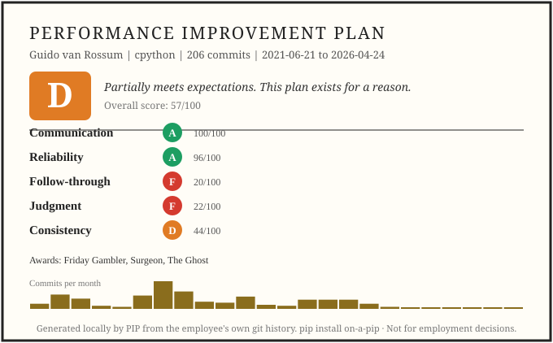
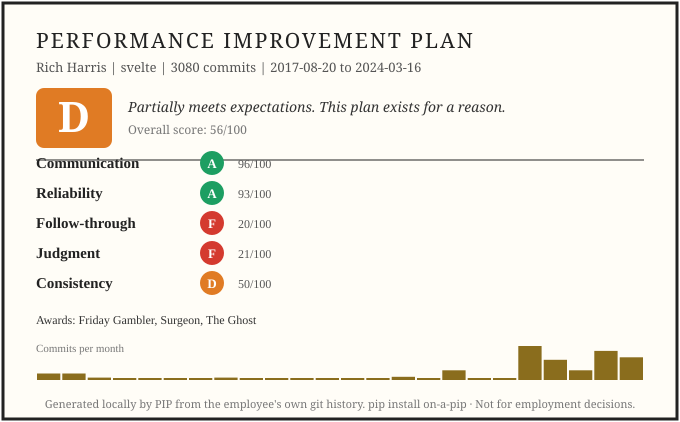
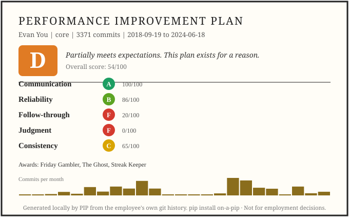
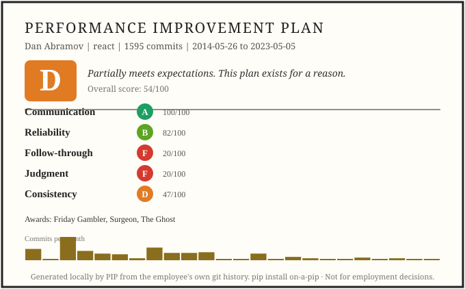
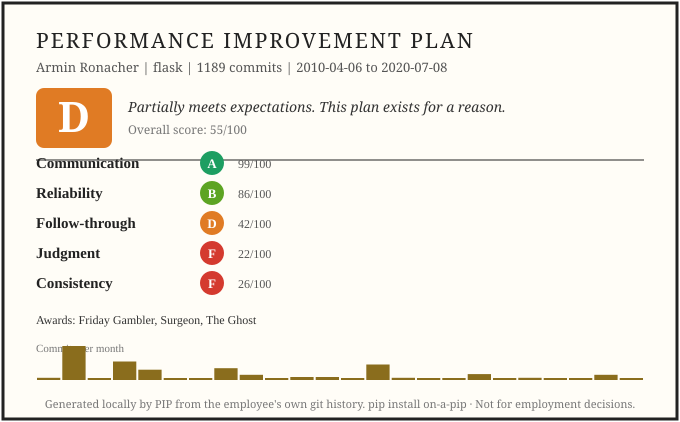
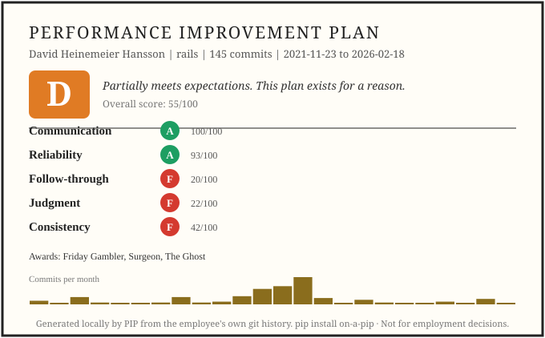
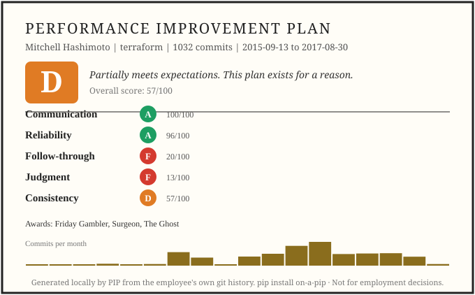
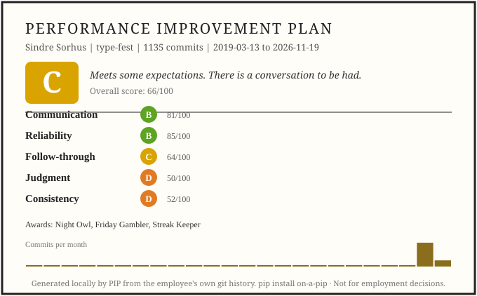

# The PIP Gallery: famous projects, formally reviewed

Every card below was generated by PIP itself from the project's real git
history. No author was consulted. Several would like to speak to HR.

## requests

Top author: **Cory Benfield**, grade **C (65/100)**, 606 commits reviewed.

| # | Author | Grade | Score | Commits |
| --- | --- | --- | --- | --- |
| 1 | Cory Benfield | C | 64.8 | 606 |
| 2 | Nate Prewitt | C | 60.3 | 348 |
| 3 | Kenneth Reitz | C | 59.1 | 928 |
| 4 | Ian Cordasco | C | 58.2 | 298 |
| 5 | Kenneth Reitz | D | 57.0 | 1006 |

[Full review of Cory Benfield](requests/review.md)

## flask

Top author: **David Lord**, grade **C (62/100)**, 1870 commits reviewed.

| # | Author | Grade | Score | Commits |
| --- | --- | --- | --- | --- |
| 1 | David Lord | C | 62.4 | 1870 |
| 2 | Ron DuPlain | C | 62.1 | 117 |
| 3 | Markus Unterwaditzer | D | 57.0 | 274 |
| 4 | Grey Li | D | 55.7 | 109 |
| 5 | Armin Ronacher | D | 55.2 | 733 |

[Full review of David Lord](flask/review.md)

## express

Top author: **Tj Holowaychuk**, grade **C (72/100)**, 2788 commits reviewed.

| # | Author | Grade | Score | Commits |
| --- | --- | --- | --- | --- |
| 1 | Tj Holowaychuk | C | 72.3 | 2788 |
| 2 | Jonathan Ong | C | 68.0 | 84 |
| 3 | Roman Shtylman | C | 67.5 | 70 |
| 4 | Ulises Gascón | C | 65.9 | 63 |
| 5 | Douglas Christopher Wilson | C | 64.1 | 1232 |

[Full review of Tj Holowaychuk](express/review.md)

## normalize-css

Top author: **battaglr**, grade **B (75/100)**, 10 commits reviewed.

| # | Author | Grade | Score | Commits |
| --- | --- | --- | --- | --- |
| 1 | battaglr | B | 75.0 | 10 |
| 2 | Nicolas Gallagher | C | 72.1 | 208 |
| 3 | Jonathan Neal | C | 69.3 | 95 |

[Full review of battaglr](normalize-css/review.md)

## fastapi

Top author: **Sebastián Ramírez**, grade **C (59/100)**, 1209 commits reviewed.

| # | Author | Grade | Score | Commits |
| --- | --- | --- | --- | --- |
| 1 | Sebastián Ramírez | C | 59.2 | 1209 |
| 2 | Yurii Motov | D | 57.4 | 72 |
| 3 | Nils Lindemann | D | 57.1 | 129 |
| 4 | Alejandra | D | 56.3 | 102 |
| 5 | Motov Yurii | D | 55.5 | 234 |

[Full review of Sebastián Ramírez](fastapi/review.md)

## vue

Top author: **Hanks**, grade **D (56/100)**, 47 commits reviewed.

| # | Author | Grade | Score | Commits |
| --- | --- | --- | --- | --- |
| 1 | Hanks | D | 56.3 | 47 |
| 2 | kazuya kawaguchi | D | 56.1 | 32 |
| 3 | chengchao | D | 55.2 | 34 |
| 4 | Eduardo San Martin Morote | D | 49.8 | 43 |
| 5 | Evan You | D | 48.8 | 2592 |

[Full review of Hanks](vue/review.md)

## prettier

Top author: **fisker Cheung**, grade **C (60/100)**, 2564 commits reviewed.

| # | Author | Grade | Score | Commits |
| --- | --- | --- | --- | --- |
| 1 | fisker Cheung | C | 59.8 | 2564 |
| 2 | SUZUKI Sosuke | D | 54.2 | 184 |
| 3 | Seiya | D | 53.5 | 50 |
| 4 | Sosuke Suzuki | D | 52.1 | 137 |
| 5 | Georgii Dolzhykov | D | 49.7 | 51 |

[Full review of fisker Cheung](prettier/review.md)

## tokio

Top author: **Alex Crichton**, grade **C (59/100)**, 357 commits reviewed.

| # | Author | Grade | Score | Commits |
| --- | --- | --- | --- | --- |
| 1 | Alex Crichton | C | 59.1 | 357 |
| 2 | Alice Ryhl | D | 55.7 | 317 |
| 3 | Alice Ryhl | D | 55.6 | 434 |
| 4 | Carl Lerche | D | 54.5 | 653 |
| 5 | Taiki Endo | D | 52.4 | 184 |

[Full review of Alex Crichton](tokio/review.md)

## steven-leake

A community entry (added Nov 19, 2026), and the gallery's first person rather than a project: **Steven Leake** (GitHub StevenLeake99, Monarch Literary). His pinned repo monarchx is a fork, so this review is filtered to his own commits in it: exactly one, a README update.

Top author: **Steven Leake**, grade **C (69/100)**, 1 commit reviewed (monarchx, author-filtered).

His own repos tell a different story: 23 commits across 12 repositories, best grade B (87.5) on monarch-x-public. The F grades on this card (Follow-through and Judgment) grade TODOs and workarounds inherited from the forked upstream code, not his writing.

[Full review of Steven Leake](steven-leake/review.md)

## guido-van-rossum

**Guido van Rossum**, creator of Python, reviewed on CPython's most recent 25,000 commits: 206 commits of his own, 2021-2026, after his BDFL era. Communication A (100) and Reliability A (96.5); the D comes from Follow-through and Judgment on CPython's ancient TODOs.

Top author: **Guido van Rossum**, grade **D (57/100)**, 206 commits reviewed (cpython, recent-25,000-commit window).

[Full review of Guido van Rossum](guido-van-rossum/review.md)

## rich-harris

**Rich Harris**, creator of Svelte, reviewed on the Svelte repo: 3,080 commits, 2017-2024. Weekend Warrior (45% of commits on Saturday or Sunday) and, the record shows, a Colourful Commentator.

Top author: **Rich Harris**, grade **D (56/100)**, 3080 commits reviewed (svelte).

[Full review of Rich Harris](rich-harris/review.md)

## evan-you

**Evan You**, creator of Vue, reviewed on Vue Core (the old Vue repo grades him D 48.8 in the entry above; Core is kinder): 3,371 commits, 2018-2024, Communication A (100).

Top author: **Evan You**, grade **D (54/100)**, 3371 commits reviewed (vuejs/core).

[Full review of Evan You](evan-you/review.md)

## dan-abramov

**Dan Abramov**, of React and Redux, reviewed on React (30,000-commit window): 1,595 commits, 2014-2023, covering the Hooks era. The Ghost: a 302-day disappearance in the record, then a return.

Top author: **Dan Abramov**, grade **D (54/100)**, 1595 commits reviewed (react, 30,000-commit window).

[Full review of Dan Abramov](dan-abramov/review.md)

## armin-ronacher

**Armin Ronacher**, creator of Flask and Jinja, reviewed on Flask by name (the flask entry above ranks him by a single identity; this review merges his identities): 1,189 commits, 2010-2020. Old Faithful: ten years on the same codebase. The Ghost: one 720-day disappearance.

Top author: **Armin Ronacher**, grade **D (55/100)**, 1189 commits reviewed (flask).

[Full review of Armin Ronacher](armin-ronacher/review.md)

## dhh

**David Heinemeier Hansson (DHH)**, creator of Rails, reviewed on Rails' most recent 30,000 commits: 145 commits of his own, 2021-2026. The window grades the chairman era, not the 2004 creation years. Fossil Keeper, extreme edition: a TODO in the tree has survived 5,896 days.

Top author: **David Heinemeier Hansson**, grade **D (55/100)**, 145 commits reviewed (rails, 30,000-commit window).

[Full review of DHH](dhh/review.md)

## mitchell-hashimoto

**Mitchell Hashimoto**, co-founder of HashiCorp, reviewed on Terraform: 1,032 commits, 2015-2017, his hands-on building years. The highest score of the famous-developer set, and the harshest Judgment grade on the board (F, 13.0).

Top author: **Mitchell Hashimoto**, grade **D (57/100)**, 1032 commits reviewed (terraform, 30,000-commit window).

[Full review of Mitchell Hashimoto](mitchell-hashimoto/review.md)

## sindre-sorhus

**Sindre Sorhus**, reviewed on type-fest: 1,135 commits, 2019-2026, and the only C in the famous-developer set. His 10-repo org board runs B 85.2 (supercharge-meta) down to F 30.6 (his personal site repo). Marathon Day: 147 commits in one day, 2026-10-24.

Top author: **Sindre Sorhus**, grade **C (66/100)**, 1135 commits reviewed (type-fest).

[Full review of Sindre Sorhus](sindre-sorhus/review.md)

*Generated by PIP. `pip install on-a-pip` and review your own history.*
